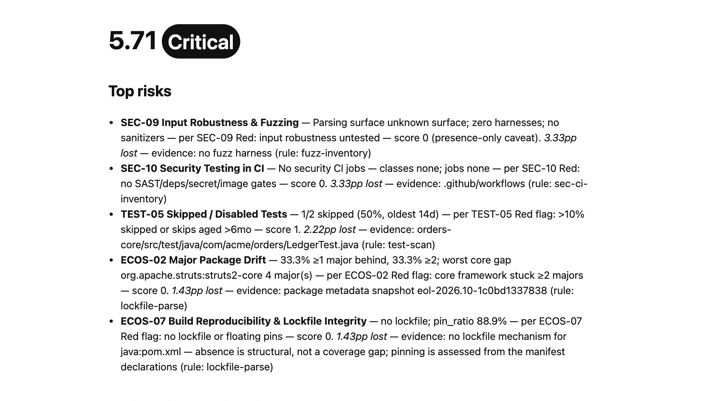

# LeapScore

LeapScore scans a codebase locally and reports structural legacy and maintainability risks against a public rubric.

> LeapScore sees the structure. The assessment understands what the code does.

**Coverage (v1.0.2, November 2026):** the rubric has 102 indicators. Up to 31 have a detector today, 25 on a local scan; the rest are disclosed as not implemented rather than scored as if they had run. **The score is not a peer benchmark.**

## Privacy by default

A local path scan reads the target on your machine and makes no network requests. It sends no code, paths, or repository names, and sends no telemetry automatically. `--repo owner/repo` is a separate, explicit remote scan: it contacts GitHub's API and shallow-clones the public repository. A report's tracked assessment URL is plain text until clicked; the scan does not contact the assessment host. Only a user click opens that URL and carries its associated click tracking.

## Run a scan

Prerequisite: Node.js 20 or newer. Nothing to clone, install, or build.

```bash
npx leapscore-scan . --out leapscore-report
```

The local scan reads `.` and writes `report.json`, `report.html`, and `report.md` to
`leapscore-report/`. `--out <dir>` is required on every sealed run. Add `--strict` for
zero-socket mode: detectors use the vendored snapshots and any attempted network access
aborts the scan.

The same artifact has two secondary forms — both run the identical bundle:

```bash
# From a checkout of this repository (contributors; installs the workspace and builds the bundle)
npm install
leapscore-scan scan . --out leapscore-report --strict

# Pin an exact commit from git (no registry access)
npx -p "github:open-legacyleap/leapscore#<sha>" leapscore-scan scan . --out leapscore-report
```

## Use it in GitHub Actions

```yaml
permissions:
  contents: read

jobs:
  leapscore:
    runs-on: ubuntu-latest
    steps:
      - uses: actions/checkout@v5
        with:
          fetch-depth: 0
      - uses: open-legacyleap/leapscore@v1
        with:
          path: .
          fail_under_band: moderate
          out_dir: leapscore-report
```

- `actions/checkout` must run first — the Action scans the checked-out working tree and does
  no clone of its own.
- `fetch-depth: 0` is recommended. A shallow checkout has no history, so history-derived
  indicators (for example `ARCH-05`, churn vs. defect hot spots) seal as `unknown` with a
  re-run hint; full history lets them measure. The scan seals either way, and the report
  discloses which rows were unscored.
- Gate on a band with `fail_under_band: critical|high|moderate|low`, or on a number with
  `fail_under: <0-100>`; they are mutually exclusive. Either gate exits `3` while still
  writing all three report files.
- Inputs: `path`, `fail_under`, `fail_under_band`, `strict`, `out_dir`, `engine_ref`,
  `baseline`, `ratchet`, `badge`.
- Pin `@v1` (the moving major tag) for automatic compatible updates, `@v1.0.0` (an immutable
  release tag) for a fixed version, or a commit SHA for the strictest pin. No moving minor
  tag is published; use the exact `vX.Y.Z` tag when you want minor-level stability.

## Sample report

Illustrative sample only: this report was produced by scanning the checked-in synthetic fixture, not a customer's repository.



Maintainers can reproduce the report and refresh this screenshot offline using [`docs/sample-report/README.md`](docs/sample-report/README.md).

## Methodology

Read the [scoring methodology](https://leapscore.dev/method) and browse the [canonical rubric](docs/rubric/README.md), which defines the indicators and thresholds behind the report.

## Next step

LeapScore assesses structural risk; it does not determine functional behavior, extract business rules, or prescribe a modernization plan. For a result-specific interpretation, use the MCM-backed **$0 Assessment** link printed in your report. Its tracked URL follows `https://leapscore.dev/assessment?utm_campaign=cli-scan-v1&band=<report-band>` and remains inert until clicked.

Maintainer architecture, implementation status, development, and repository-boundary guidance lives in [`AGENTS.md`](AGENTS.md).
