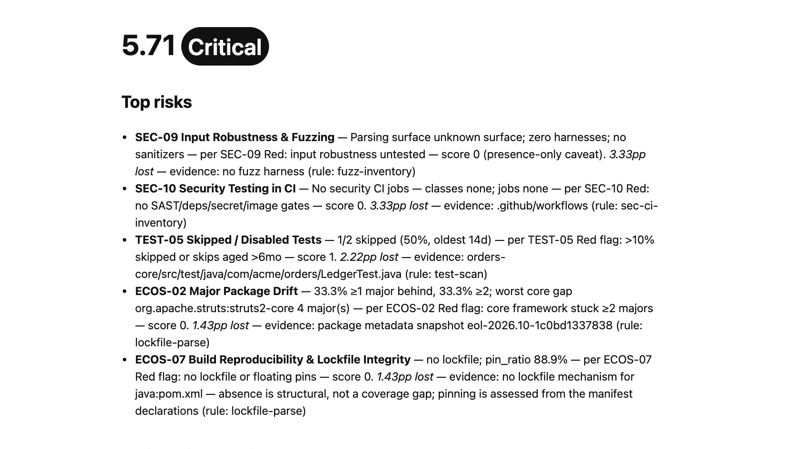

# Sample report

This screenshot shows the CLI report for a checked-in synthetic Java/Maven fixture. It is an illustration of report layout and findings, not a report about a customer repository or a guarantee that the scanner measures every rubric indicator.



The fixture lives at `apps/scanner/src/scan/__tests__/fixtures/legacy-stacks/maven-multi-module`. The [refresh script](./refresh.sh) runs the scanner with `--strict`, writes reports to a temporary directory, and captures the HTML report as [`sample-report.png`](../sample-report.png). The [capture script](./capture.py) hides machine-specific metadata and rejects external browser requests; it does not synthesize or alter report findings. The temporary report directory is removed when the script exits.

## Refresh the screenshot

From the repository root:

```bash
npm install
npm run build:cli
docs/sample-report/refresh.sh
```

Requirements: Node.js 20 or newer; Python 3 with Playwright installed; and Chrome or Chromium. Set `CHROME_BIN` if the browser is not found automatically. Install dependencies and build the CLI before running offline. The refresh uses the strict local scan and the capture script blocks non-file browser requests.

Review the image before committing it. Scan metadata is excluded from the screenshot, but the visible score, findings, and report text come from the generated report for this fixture.
